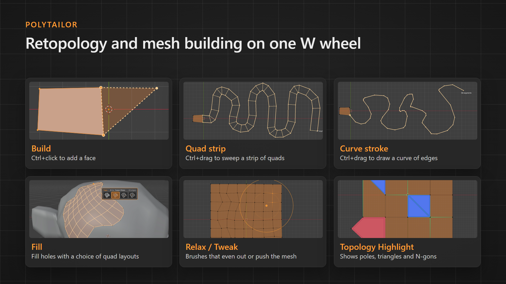
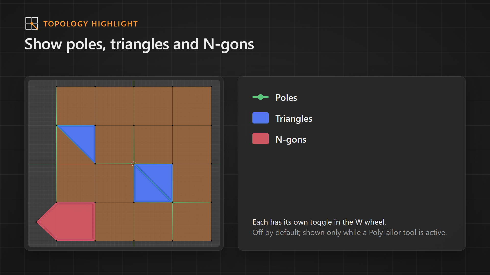

# PolyTailor

PolyTailor is a retopology and mesh-building add-on for Blender's Mesh Edit Mode: Build, Fill, Relax and Tweak on one wheel under **W**.

**Get the latest version (1.2.0) from [Blender Extensions](https://extensions.blender.org/add-ons/polytailor/)**, or in Blender: Edit > Preferences > Get Extensions, search "PolyTailor". Requires Blender 4.5 or newer.

## See it in action

### Fill
Hold Ctrl over an outline to preview the fill, step through the layouts with Ctrl+Wheel, and Ctrl+click to add it.

<!-- VIDEO: fill.mp4 -->

https://github.com/user-attachments/assets/5a9f01f6-2f75-45e0-86ad-5968f7a5a2a5

### Build
Hold Ctrl to preview, Ctrl+click to add, drag to move.

<!-- VIDEO: build.mp4 -->

https://github.com/user-attachments/assets/0bd60fc6-f3ce-45be-9b9c-eb690358bdac

### Curve stroke and quad strip
Ctrl+drag draws a curve stroke or sweeps a quad strip.

<!-- VIDEO: drag_build.mp4 -->

https://github.com/user-attachments/assets/5def35b2-c966-44df-8c39-dd13226bcf6a

### Relax and Tweak
Relax evens out the mesh under the brush; Tweak pushes the vertices under it.

<!-- VIDEO: relax_tweak.mp4 -->

https://github.com/user-attachments/assets/ca2f5656-2a8a-4180-b62a-263bd960bbe1

### Topology Highlight
Marks poles, triangles and N-gons, each with its own toggle in the W wheel.

## What's new in 1.2.0

- Fill follows the curvature of the surrounding surface instead of filling flat.
- Topology Highlight: a new W wheel section marks poles, triangles and N-gons.
- The Fill HUD shows the mode (Topo or Normal) first.
- The W wheel opens centered at the cursor and has a Select Box button.
- "3D" mode is now called "Normal", and new scenes start in Topo.
- Build: curve strokes stay on the surface you started on.

The full list is in the [changelog](CHANGELOG.md).

## This repository

- [`source/`](source) holds the source code of version 1.1.0, with its manual in [`source/README.md`](source/README.md). The current version is on Blender Extensions.
- Report bugs and ask questions in [Issues](../../issues). Plans are in the [roadmap](ROADMAP.md).
- News: [@PolyTailor on X](https://x.com/PolyTailor)
- Tested on Windows. License: GPL-3.0-or-later.
